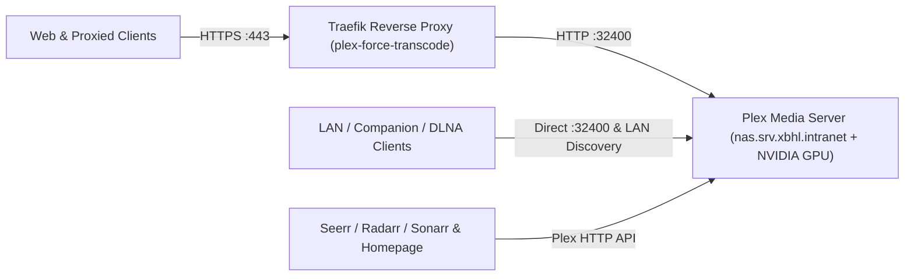

# Plex Media Server

> Version: `1.43.5.11079-b3b13e506-amd64` | Image: `plexinc/pms-docker:1.43.5.11079-b3b13e506-amd64` | Upstream: https://github.com/plexinc/pms-docker

Central media streaming server for the homelab, running directly on the QNAP NAS host alongside primary media storage and an NVIDIA GPU for hardware-accelerated transcoding.

## Overview

| Property | Value |
| :--- | :--- |
| **Domain** | `https://plex.intranet.xbhl.online` |
| **Node** | `nas.srv.xbhl.intranet` (QNAP NAS bare-metal host) |
| **Ingress** | Traefik TLS reverse proxy (`plex-force-transcode`) + host TCP/UDP ports for LAN streaming & discovery |
| **Authentication** | Native Plex.tv account & token auth (Authelia omitted for client compatibility) |
| **Ecosystem** | Seerr & `*arr` library consumer, Homepage (`Media` tile & widget), WUD |

## Architecture & Key Decisions

- **QNAP NAS Co-Location & GPU Transcoding**: Deployed directly on `nas.srv.xbhl.intranet` rather than a Proxmox VM so Plex reads local QNAP media shares without NFS overhead, reserves an NVIDIA GPU for NVENC/NVDEC hardware acceleration, and writes ephemeral transcode segments to world-writable RAM-backed `tmpfs`.
- **Dual Ingress (Forced-Transcode Proxy vs Direct LAN)**: Proxied HTTPS traffic passes through Traefik's `plex-force-transcode` (`query-modification`) middleware—rewriting `directPlay` and `directStream` query parameters to `0` to force server-side transcoding without custom XML client profiles—while host-published `:32400` and Companion/DLNA/GDM ports serve direct LAN discovery and streaming.
- **Curated Shares vs Automated Request Libraries**: Separates curated QNAP media shares (`/multimedia/*`) from the shared `/torrent` hierarchy where Seerr, Radarr, and Sonarr provision automated `/torrent/requests/*` libraries.
- **Native Plex.tv Authentication**: Authenticates web, TV, and mobile apps directly via Plex.tv accounts and tokens, intentionally omitting Authelia forward-auth on `plex-router` so native Plex clients connect unimpeded.

### External Credentials

- `PLEX_CLAIM`: Manual Plex.tv server claim token (`https://www.plex.tv/claim/`) stored in GitLab CI/CD variables for first-run server registration when `PlexOnlineToken` is absent.

## Upgrades & Maintenance

- **Upstream & Wrapper Sources**: Release notes are published in the [Plex Media Server forum thread](https://forums.plex.tv/t/plex-media-server/30447/last) (`wud.link.template`), while container packaging and `s6` init scripts live at <https://github.com/plexinc/pms-docker>.
- **Version & Flavor Constraints**: Pin immutable `<version>-<hash>-amd64` tags (`wud.tag.include` / `wud.tag.transform` mapping 4-part builds to 3-part semver) rather than self-updating `public`/`beta` tags; `VERSION=docker` is an inert LinuxServer.io leftover ignored by `plexinc/pms-docker`.
- **Intentional Choices (Do Not Propose)**: Keep Traefik's `plex-force-transcode` middleware instead of XML client profiles, omit Authelia on `plex-router`, preserve `mode=1777` RAM `tmpfs` and host LAN/DLNA/GDM ports alongside `proxy`, and rely on the image's built-in `/healthcheck.sh` without a Compose `healthcheck` block.
- **Upgrade & CI Gotchas**: `.gitlab-ci.yml` overrides `test:plex:docker-compose` as a no-op because CI DinD runners lack the reserved NVIDIA GPU and QNAP host media paths, uses singular `src/.env` Compose interpolation (`container-healthcheck-delay: 300`), and only consumes `PLEX_CLAIM` during `40-plex-first-run` if `PlexOnlineToken` is missing.
