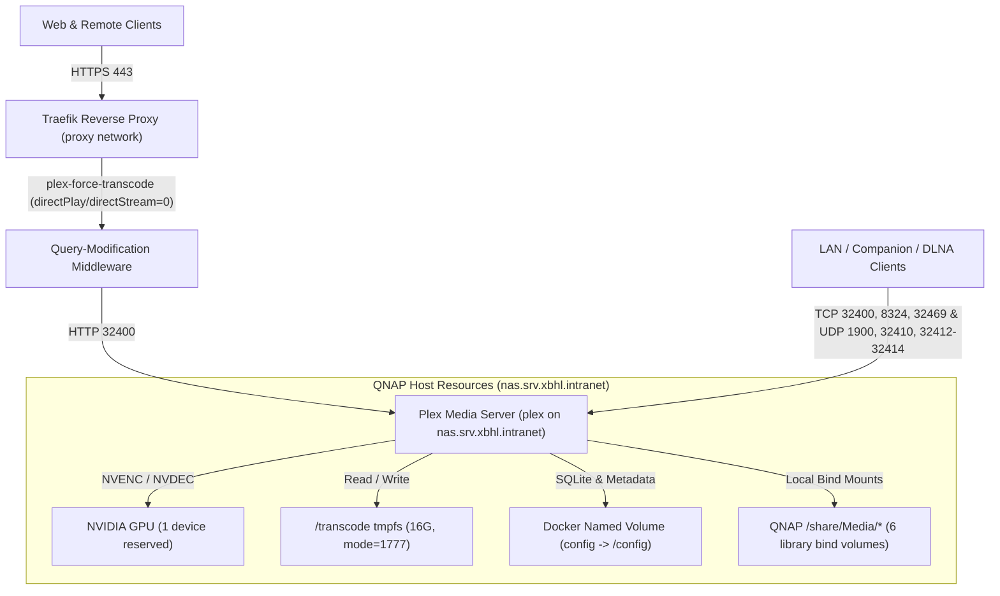

# Plex Media Server

> Version: `1.43.5.11079-b3b13e506-amd64` | Image: `plexinc/pms-docker:1.43.5.11079-b3b13e506-amd64` | Upstream: https://github.com/plexinc/pms-docker

Plex Media Server is the central media streaming server for the homelab, running directly on the QNAP NAS host with NVIDIA GPU hardware transcoding, RAM-backed `/transcode` `tmpfs` scratch storage, and direct local bind mounts to QNAP `/share/Media/*` libraries.

## Service Overview

| Property | Value |
| :--- | :--- |
| **Domain** | `https://plex.intranet.xbhl.online` |
| **Primary Node** | `nas.srv.xbhl.intranet` (`QNAP NAS Bare-Metal Host`) |
| **Deploy Path** | `/share/Container/services/plex` |
| **Ingress Strategy** | `direct` (Traefik TLS Reverse Proxy -> HTTP `:32400` via `plex-force-transcode`; host TCP/UDP ports for LAN PMS, Companion, DLNA, and GDM) |
| **Topology Archetype** | `Standalone Application` |
| **Authentication** | Native Plex Account & Claim Token (`PLEX_CLAIM`; Authelia omitted on `plex-router` for native client compatibility) |
| **Ecosystem** | Homepage (`Media` group tile & `plex` widget on `https://start.intranet.xbhl.online`), WUD (`wud.watch=true`); not registered in Gatus or Authelia |

## Architecture & Communication

Plex runs as a single `plex` container (`hostname: plex.ctr.xbhl.intranet`) deployed via `docker-compose-service-deployment` directly onto `nas.srv.xbhl.intranet`:
- **Reverse Proxy Ingress & Forced Server-Side Transcoding**: The container joins the external `proxy` Docker network (`traefik.docker.network=proxy`), where Traefik router `plex-router` (`Host(\`${PLEX_DOMAIN:?err}\`)`, `entrypoints=websecure`, `tls=true`) forwards HTTPS traffic to container HTTP port `32400` (`ADVERTISE_IP=https://${PLEX_DOMAIN:?err}:443/`). Traefik's `query-modification` plugin middleware `plex-force-transcode` rewrites `^(directPlay|directStream)$$` query parameters to `0`, enforcing server-side transcoding without custom XML client profiles. Authelia forward-auth middleware is intentionally omitted so native Plex Web, TV, and mobile clients authenticate directly with Plex tokens.
- **LAN Discovery, Companion & DLNA**: Alongside the `proxy` network, `src/docker-compose.yml` publishes host TCP and UDP ports directly on `nas.srv.xbhl.intranet` for local network discovery and direct LAN streaming.
- **NVIDIA Hardware Acceleration & Storage**: The stack reserves 1 NVIDIA GPU (`deploy.resources.reservations.devices` with `driver: nvidia`, `count: 1`, `capabilities: [ gpu ]`, `NVIDIA_VISIBLE_DEVICES=all`, `NVIDIA_DRIVER_CAPABILITIES=all`) and mounts `/transcode` on a `16G` `mode=1777` `tmpfs`. Because `plex` executes directly on `nas.srv.xbhl.intranet`, media libraries are mounted via `driver: local` (`type: none`, `o: bind`) from `/share/Media/*` rather than remote NFS, while `/config` uses a local Docker named volume (`config`) to preserve POSIX file locking for Plex's SQLite databases.
- **CI Artifact Injection & DinD GPU Test Override**: In `.gitlab-ci.yml`, `setup:generate-build-artifacts` copies `src/.env` into `$BUILD_ARTIFACTS_DIR` and injects `PLEX_CLAIM` and `PLEX_DOMAIN=${SERVICE_HOSTNAME}` via `sed -i` for Docker Compose `.env` interpolation (without `env_file:`). `test:plex:docker-compose` is overridden as a no-op echo because GitLab CI DinD runners lack the NVIDIA GPU required by `deploy.resources.reservations.devices` (and QNAP `/share/Media/*` paths). Deployment sets `container-healthcheck-delay: 300` (`delete-existing-container-files: true`) and relies on the upstream image's built-in `/healthcheck.sh`.

### Host-Published Ports

| Port Mapping | Protocol | Service / Purpose |
| :--- | :--- | :--- |
| `32400:32400` | `TCP` | Plex Media Server HTTP/HTTPS API & LAN streaming |
| `8324:8324` | `TCP` | Plex Companion / Roku control |
| `32469:32469` | `TCP` | Plex DLNA Server |
| `1900:1900` | `UDP` | Plex DLNA SSDP discovery |
| `32410:32410`, `32412:32412`, `32413:32413`, `32414:32414` | `UDP` | GDM local network discovery (`32411/udp` intentionally omitted) |

### Storage & Mounts

| Volume / Mount | Type & Driver Options | Host Source (`nas.srv.xbhl.intranet`) | Container Path | Purpose |
| :--- | :--- | :--- | :--- | :--- |
| `config` | Named volume (`driver: local`) | Local Docker volume store | `/config` | Plex SQLite database, metadata, and `Preferences.xml` (`PLEX_UID=1000`, `PLEX_GID=100`) |
| *(tmpfs)* | `tmpfs` (`rw,size=16G,mode=1777`) | Host RAM | `/transcode` | Ephemeral hardware transcoding scratch directory |
| `torrent` | Named volume (`local`, `type: none`, `o: bind`) | `/share/Media/Torrent` | `/torrent` | Torrent media directory |
| `movies` | Named volume (`local`, `type: none`, `o: bind`) | `/share/Media/Movies` | `/multimedia/movies` | Movies library |
| `tv` | Named volume (`local`, `type: none`, `o: bind`) | `/share/Media/TV` | `/multimedia/tv` | TV series library |
| `music` | Named volume (`local`, `type: none`, `o: bind`) | `/share/Media/Music` | `/multimedia/music` | Music library |
| `photos` | Named volume (`local`, `type: none`, `o: bind`) | `/share/Media/Photos` | `/multimedia/photos` | Photos library |
| `other` | Named volume (`local`, `type: none`, `o: bind`) | `/share/Media/Other` | `/multimedia/other` | Other media library |

## Required GitLab CI/CD Variables

Project-level variable in GitLab (**Settings** > **CI/CD** > **Variables**), alongside group-inherited deployment credentials (`SSH_USER`, `SSH_PRIVATE_KEY`, `CLOUDFLARE_ZONE_ID`, `CLOUDFLARE_DNS_API_TOKEN`):

| Variable Name | Consumed By | Masked | Purpose |
| :--- | :--- | :--- | :--- |
| `PLEX_CLAIM` | `.gitlab-ci.yml` (`setup:generate-build-artifacts`) | Yes | Plex account claim token injected into `$BUILD_ARTIFACTS_DIR/.env` for `${PLEX_CLAIM:?err}` Compose interpolation during first-run server registration (`40-plex-first-run`). |

## Upgrades & Maintenance

- **Upstream & Wrapper Sources**: Release announcements tracked via `wud.link.template` (Plex Forum thread); official container wrapper repository and entrypoint scripts at <https://github.com/plexinc/pms-docker>.
- **Version & Flavor Constraints**: Locked to immutable `plexinc/pms-docker` `<major>.<minor>.<patch>.<build>-<hash>-amd64` tags (`wud.tag.include=^\d+\.\d+\.\d+\.\d+-[a-f0-9]+-amd64$$`, `wud.tag.transform` mapping 4-part builds to 3-part semver `$$1.$$2.$$4`) rather than self-updating `public`/`beta` tags; `VERSION=docker` in `src/docker-compose.yml` is an inert LinuxServer.io leftover ignored by `plexinc/pms-docker`.
- **Intentional Choices (Do Not Propose)**: Server-side transcoding is enforced via Traefik's `plex-force-transcode` `query-modification` plugin middleware (`^(directPlay|directStream)$$` -> `0`) rather than XML client profiles; `plex-router` omits Authelia middleware for native Plex client compatibility; `/transcode` runs on a `16G` `mode=1777` `tmpfs` with NVIDIA GPU reservation (`driver: nvidia`, `count: 1`) on `nas.srv.xbhl.intranet`; `proxy` network coexists with host-published LAN/DLNA/GDM ports (`32400/tcp`, `8324/tcp`, `32469/tcp`, `1900/udp`, `32410/udp`, `32412-32414/udp`), local SQLite `/config` storage (`driver: local`), and direct QNAP `/share/Media/*` bind mounts; omits a Compose `healthcheck` block in favor of the image's built-in `/healthcheck.sh`.
- **Upgrade & CI Gotchas**: `.gitlab-ci.yml` overrides `test:plex:docker-compose` as a no-op echo because CI DinD runners lack the NVIDIA GPU required by `deploy.resources.reservations.devices`, overrides `setup:generate-build-artifacts` (`cp src/.env` + `sed` injection of `PLEX_CLAIM` and `PLEX_DOMAIN=${SERVICE_HOSTNAME}`) to overwrite `src/.env` placeholders for Compose interpolation, and sets `container-healthcheck-delay: 300` (`delete-existing-container-files: true`); `PLEX_CLAIM` is only exchanged by `40-plex-first-run` when `PlexOnlineToken` is absent from `/config`.
